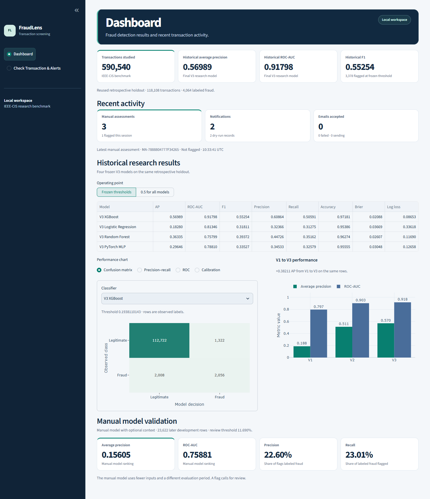

# FraudLens: An Explainable Machine Learning System for Financial Fraud Detection and Behavioral Risk Intelligence

FraudLens is a non-commercial academic project that combines historical fraud research with a local transaction review tool. The Streamlit application has two pages:

- **Dashboard** compares the four frozen V3 research classifiers, shows historical evaluation charts and summarizes recent session activity. Optional sections cover experiments, neural learning curves and behavioral analytics.
- **Check Transaction & Alerts** evaluates four required form inputs and two optional fields with a separately trained XGBoost model. It shows the risk score, review decision, recommended action, grouped TreeSHAP contributions, assessment reference and UTC time. The same page holds the assessment and alert histories.



[Local transaction checker](docs/screenshots/release/local/02-check-transaction.png) · [Public dashboard](docs/screenshots/release/public/01-dashboard.png) · [Public workflow](docs/screenshots/release/public/02-check-transaction.png)

## Architecture and data

| Component | Role |
| --- | --- |
| Research pipeline | Joins and validates IEEE-CIS transaction and identity data. Builds causal historical features, evaluates chronological folds and freezes model, preprocessing and policy artifacts before retrospective scoring. |
| Local product | Reads the frozen aggregate research report and runs the separate six-input manual checkpoint, TreeSHAP and session-scoped email alerts. |
| Standalone public demo | Shows aggregate historical results and an illustrative workflow using the same two page names. Transaction input, inference and email delivery are unavailable. |
| Archive | Preserves the earlier interfaces, historical replay, research code and experiment protocols for reproduction. |

The IEEE-CIS Fraud Detection dataset is provided by IEEE-CIS and Vesta through Kaggle. It contains **590,540 transaction rows**, including **20,663 labeled frauds**, and **144,233 identity rows**. The one-to-one left join retains transactions with missing identity. Behavioral histories use strictly earlier timestamp groups and approximate entity keys. Fitting uses chronological development partitions. The V3 research policies were frozen before the retrospective evaluation. [Dataset on Kaggle](https://www.kaggle.com/competitions/ieee-fraud-detection/data)

## Frozen research results

All rows below use the same **118,108-row reused retrospective holdout** from V1 and V2. The final V3 XGBoost uses 497 candidate features, depth 10, identity calibration and cutoff **0.1938110143**. AP and ROC-AUC use ranking scores. Precision, recall, F1 and accuracy use each model’s frozen cutoff.

| V3 research model | AP | ROC-AUC | Precision | Recall | F1 | Accuracy |
| --- | ---: | ---: | ---: | ---: | ---: | ---: |
| Logistic Regression | 0.18280 | 0.81346 | 0.32366 | 0.31275 | 0.31811 | 0.95386 |
| Random Forest | 0.36335 | 0.75799 | 0.44726 | 0.35162 | 0.39372 | 0.96274 |
| **XGBoost** | **0.56989** | **0.91798** | **0.60864** | **0.50591** | **0.55254** | **0.97181** |
| PyTorch MLP | 0.29646 | 0.78810 | 0.34533 | 0.32579 | 0.33527 | 0.95555 |

On these same rows, AP rose from **0.18778** for V1 XGBoost to **0.51147** for the V2 weighted ensemble and **0.56989** for V3. The V3 XGBoost flagged 3,378 rows and identified 2,056 of 4,064 labeled frauds. [Frozen results and all operating points](docs/V3_STEP7C.md)

## Manual assessment results

The form uses amount, card network, card type and purchaser email provider category, plus optional device type and recipient email provider category. It asks for provider categories rather than addresses. The model was fitted on 354,324 development rows. Earlier policy data selected the **0.1169009730** cutoff by F1. The following metrics use the **later 23,622 development rows**.

| Manual model | AP | ROC-AUC | Precision | Recall | F1 | Flagged for review |
| --- | ---: | ---: | ---: | ---: | ---: | ---: |
| Prior four-input model, prior live cutoff | 0.09275 | 0.70124 | 10.97% | 39.04% | 0.17125 | 2,954 (12.51%) |
| **Final six-input model** | **0.15605** | **0.75881** | **22.60%** | **23.01%** | **0.22806** | **845 (3.58%)** |

The final manual model raises precision and reduces review workload, with lower recall at its selected operating point. These development figures apply to the manual model and its evaluation population. [Controlled comparison and reproduction](docs/V3_MANUAL_CHALLENGER.md)

## Install and launch locally

Use **64-bit Python 3.11** on Windows. From the repository root, create one environment for the product, research scripts and tests. The commands below use the verified CPU build of PyTorch.

```powershell
Set-Location 'C:\path\to\fraudlens'
$env:PYTHONPATH = ''
py -3.11 -m venv .venv
$python = (Resolve-Path '.venv/Scripts/python.exe').Path
& $python -m pip install --index-url https://download.pytorch.org/whl/cpu 'torch==2.14.1+cpu'
& $python -m pip install -r requirements-release.txt
& $python -m pip check
```

The complete local application expects locally obtained artifacts. The existing V3 workspace uses `artifacts/v3`, with V1 and V2 roots configured below. A fresh source checkout can immediately use the aggregate demo. For a full local setup, see the artifact inventory and reproduction map in the [project reference](docs/FINAL_PROJECT_REFERENCE.md#reproduction-map).

```powershell
$env:FRAUDLENS_ARTIFACTS = 'E:\fraudlens\artifacts'
$env:FRAUDLENS_V2_ARTIFACTS = 'E:\fraudlens-v2\artifacts\v2'
$env:FRAUDLENS_V3_ARTIFACTS = (Resolve-Path 'artifacts/v3').Path
$env:FRAUDLENS_PUBLIC_DEMO = '0'
$env:FRAUDLENS_SMTP_ENABLED = '0'
& $python -B -m streamlit run app.py --server.address 127.0.0.1 --server.port 8526
```

Open [FraudLens locally](http://127.0.0.1:8526). In **Check Transaction & Alerts**, try **Debit · $49.95** and **Credit · $899.99** with optional details unspecified. These synthetic inputs yield approximately **2.05%**, unflagged, and **18.45%**, flagged. Open the explanation and alert history to see the actual model contributions and dry-run record.

To run the complete suite with the same environment and artifact paths:

```powershell
$env:OMP_NUM_THREADS = '6'
$env:OPENBLAS_NUM_THREADS = '6'
$env:MKL_NUM_THREADS = '6'
& $python -B -m pytest -q -rs
```

## Public demo and email

The [separate FraudLens public demo repository](https://github.com/shashwatt22/fraudlens-demo) hosts the aggregate-only demonstration source.

Export the five-file public demo into a fresh empty directory and launch it from that directory. The host needs only the dependencies in the exported `requirements.txt`.

```powershell
$demo = 'artifacts/v3/public-demo-submit'
& $python -B scripts/package_public_demo.py $demo
Push-Location $demo
& $python -B -m streamlit run app.py --server.address 127.0.0.1 --server.port 8527
Pop-Location
```

Local alerts start in **Dry run**. The authorized SMTP workflow requires provider settings in the server process environment, a restart and explicit session activation. **SMTP accepted** records relay acceptance. Verify actual delivery in the authorized inbox. [Exact SMTP settings and test steps](docs/FINAL_PROJECT_REFERENCE.md#authorized-local-email)

## Limitations and publication

The benchmark is historical, imbalanced and limited to one source. Entity keys are proxies. The retrospective rows were reused across versions, and manual results come from development data with lower input coverage. Manual scores support review and have no separate calibration or prospective validation. SHAP explains model behavior; a flag is a recommendation to investigate. The app keeps recent manual assessments and alerts in session memory.

The original FraudLens source code is released under the [MIT License](LICENSE). It does not extend to the IEEE-CIS dataset, trained model artifacts or third-party components. Obtain the dataset directly from Kaggle under its rules. Dataset attribution and code-sharing requirements are described in the Kaggle competition rules. Streamlit Community Cloud requires an eligible account holder aged 18 or older. [Kaggle rules](https://www.kaggle.com/c/ieee-fraud-detection/rules) · [Streamlit terms](https://streamlit.io/terms-of-use) · [Deployment guide](docs/V3_STEP11.md)

[Final project reference](docs/FINAL_PROJECT_REFERENCE.md) · [Release verification](docs/RELEASE_VERIFICATION.md) · [Archived experiments and interfaces](docs/archive/README.md)
