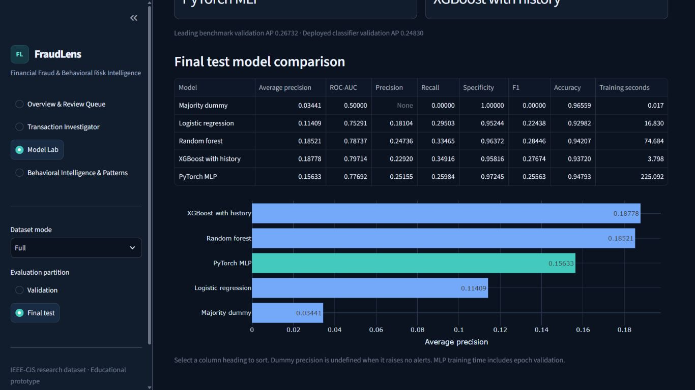
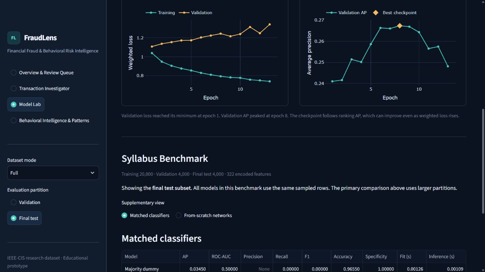
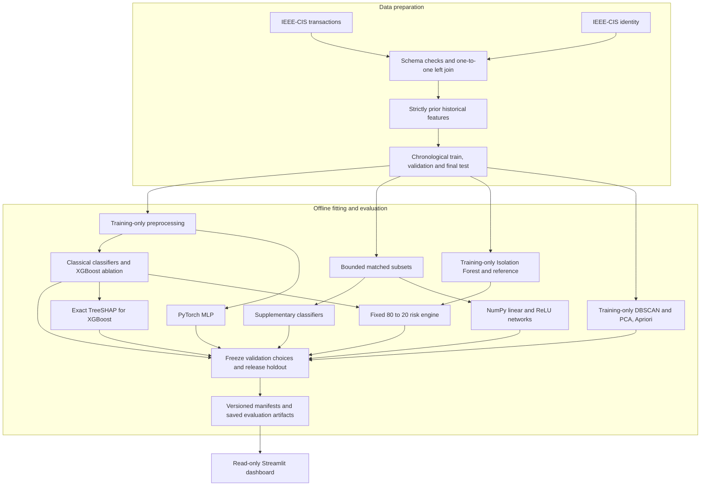

# FraudLens

**Financial Fraud & Behavioral Risk Intelligence**

      

FraudLens is a local investigation workbench for ranking and explaining suspicious financial transactions. It builds strictly historical card-and-address features, evaluates classical and neural models on a later holdout, and turns saved predictions into a review queue with on-demand TreeSHAP. The dashboard lets an analyst inspect the evidence behind a score and explore how a threshold changes the review workload.

[Dashboard](#dashboard) · [Architecture](#architecture) · [Results](#final-holdout-results) · [NumPy implementation](#neural-networks-from-scratch) · [Reproduce](#reproduce-on-windows)

| Evaluation scale | Engineering measurements | Final XGBoost |
| :--- | :--- | :--- |
| **590,540** transactions processed | **433.16 s** full pipeline | **0.79714** ROC-AUC |
| **118,108** final holdout transactions | **1.23 GiB** peak pipeline working set | **0.18778** average precision |
| **51,201** trainable MLP parameters | **≈3 s** to first dashboard render | **84** tests passed with verified artifacts |
| **4** interactive dashboard pages | **6** CPU training threads | |

Measurements are from the verified Windows run with Python 3.11.8, an Intel Core i5-12450H, 15.7 GiB RAM and six training threads. Startup is the measured localhost render with artifacts already present.

## Why this problem is hard

Fraud accounts for about 3.5% of the processed transactions. A majority classifier can appear accurate while catching no fraud. Increasing sensitivity can catch more fraud and send more legitimate transactions for review. Chronological evaluation tests the models on later activity, where spending patterns and fraud behavior can shift. Historical features give a reviewer behavioral context, and TreeSHAP explains how the classifier used its inputs. FraudLens is an educational investigation-support prototype for a human reviewer.

## Dashboard


*Portfolio overview. Aggregate transaction activity and review priorities in full mode.*

| [Final-test model comparison](docs/screenshots/05-model-comparison.jpg) | [PyTorch learning curves](docs/screenshots/06-neural-learning-curves.jpg) |
| :---: | :---: |
|  |  |
| Compare the classical and neural benchmarks on the same holdout. | Inspect weighted loss and see why validation AP selected epoch 8. |

| Page | What you can do |
| :--- | :--- |
| **Overview & Review Queue** | Compare aggregate activity by period. Rank by classifier score, anomaly or composite risk. Filter the review queue, export locally, and open a transaction in the Investigator. |
| **Transaction Investigator** | Inspect strictly prior context and the frozen decision, compute signed TreeSHAP contributions on demand, and reveal the observed label after forming an assessment. |
| **Model Lab** | Compare precision–recall and ROC curves, confusion matrices, learning curves and ablations. Explore a threshold on validation while final test results stay frozen. Inspect the matched benchmarks and NumPy checks. |
| **Behavioral Intelligence & Patterns** | Explore training-reference anomalies, DBSCAN clusters in a PCA projection, Apriori rules evaluated on validation, and grouped global SHAP. |

## Architecture



Offline jobs fit models, select checkpoints and thresholds on validation, and persist the scorer, preprocessing and evaluation artifacts. The dashboard reads the selected run's compatible artifacts. Interactive work uses saved scores for threshold scenarios and reloads the fitted XGBoost model for individual TreeSHAP explanations.

## Data and evaluation protocol

The source is the IEEE-CIS Fraud Detection dataset hosted by Kaggle. The raw transaction and identity files have **590,540 × 394** and **144,233 × 41** dimensions respectively. The loader selects 15 and 3 columns and preserves every transaction with a validated identity left join. The joined feature table has 27 columns. [IEEE-CIS dataset](https://www.kaggle.com/competitions/ieee-fraud-detection/data) · [Competition rules](https://www.kaggle.com/competitions/ieee-fraud-detection/rules)

| Partition | Transactions | Fraud cases | Fraud rate |
| :--- | ---: | ---: | ---: |
| Train | 354,324 | 11,988 | 3.3833% |
| Validation | 118,108 | 4,611 | 3.9041% |
| Final test | 118,108 | 4,064 | 3.4409% |

The entity proxy combines `card1`, `card2`, `addr1` and `addr2`. For a transaction at time *t*, every history calculation uses transactions strictly before *t*. Equal-timestamp transactions share the same eligible history. Split boundaries preserve whole timestamp groups, and incomplete entity keys receive a cold start.

| Historical feature | Calculation |
| :--- | :--- |
| `prior_txn_count` | Number of strictly earlier transactions for the proxy |
| `prior_mean_amount` | Mean observed amount across those transactions |
| `amount_to_prior_mean` | Current amount divided by a positive prior mean |
| `seconds_since_prior_txn` | Elapsed seconds since the latest strictly earlier transaction |
| `prior_count_1h` | Prior transactions in `[t − 3,600, t)` |
| `prior_count_24h` | Prior transactions in `[t − 86,400, t)` |
| `is_new_product` | 1 when this known product category has no earlier observation for the proxy |

Training fits median imputation, missing-value indicators, numeric standardization and capped one-hot encoding with missing and unseen-category handling. Supported classifiers use balanced weights or the training negative-to-positive ratio. The MLP uses that ratio as the positive-class weight in its logit loss. IDs and entity keys stay out of model inputs.

The full pipeline freezes fits and validation choices before it opens the final holdout for evaluation. Validation selects checkpoints and maximizes F1 for decision thresholds. Quick mode uses 100,000 early transactions, with **zero overlapping IDs** and an earlier end timestamp than the final holdout. [Frozen experiment protocol](docs/EXPERIMENT_PROTOCOL.md)

## Final holdout results

AP is average precision. ROC-AUC, precision, recall and F1 below come from the full final holdout. Precision is undefined for the dummy model because it predicted no positive labels.

| Model | Validation AP | Final AP | ROC-AUC | Precision | Recall | F1 |
| :--- | ---: | ---: | ---: | ---: | ---: | ---: |
| Majority dummy | 0.03904 | 0.03441 | 0.50000 | — | 0.00000 | 0.00000 |
| Logistic Regression | 0.21998 | 0.11409 | 0.75291 | 0.18104 | 0.29503 | 0.22438 |
| Random Forest | 0.21233 | 0.18521 | 0.78737 | 0.24736 | 0.33465 | 0.28446 |
| **XGBoost with history** | 0.24830 | **0.18778** | **0.79714** | 0.22920 | **0.34916** | 0.27674 |
| PyTorch MLP | **0.26732** | 0.15633 | 0.77692 | **0.25155** | 0.25984 | 0.25563 |

- **Classical versus neural.** The PyTorch MLP led validation AP. It restored epoch **8 of 13** from a `331 → 128 → 64 → 1` network with batch normalization, ReLU, dropout and Adam. Behavioral XGBoost was selected for the dashboard by validation AP among the learned classical candidates. It also had the highest final AP in the primary comparison.
- **Behavioral ablation.** Adding history reduced final AP from **0.19348** to **0.18778**, while raising ROC-AUC from **0.79313** to **0.79714** and recall from **0.32825** to **0.34916**. The result depends on the metric and the proxy's usefulness.
- **Pattern discovery.** DBSCAN found **3 clusters** and **7.50% noise** in 12,000 training observations, with silhouette **0.38743**. PCA is a visualization of the fitted sample. Two Apriori rules carried to validation, with lift **2.805** for no prior history and **1.579** for high amount with high 24-hour activity.
- **Matched supplementary models.** On the separate 20,000 training, 4,000 validation and 4,000 final subsets, Random Forest led validation AP (**0.24333**) and XGBoost led final AP (**0.22259**). These scores describe the matched subset experiment.

The technical summary includes confusion matrices, frozen thresholds, fit and scoring times, review budgets and matched comparisons. [Complete results](docs/PROJECT_SUMMARY.md)

## Neural networks from scratch

`ScratchNetwork` implements a linear logit model and a one-hidden-layer **ReLU-32** model using NumPy. It explicitly initializes weights and biases, computes forward activations, uses a stable sigmoid, and differentiates weighted binary cross-entropy with L2 on weights. Mini-batch gradient descent applies the hand-derived gradients. [NumPy implementation](src/scratch_neural.py) · [Independent numerical and autograd checks](src/scratch_checks.py)

For the shallow model, let $H = \operatorname{ReLU}(XW_1 + b_1)$ and $z = HW_2 + b_2$. The linear model computes $z$ directly from $X$. For a batch of $m$ labeled examples, $w_i$ is the training-derived positive weight for fraud rows and 1 otherwise.

$$
L = \frac{1}{m}\sum_{i=1}^m w_i\bigl[\operatorname{softplus}(z_i)-y_i z_i\bigr] + \frac{\lambda}{2}\sum_j \lVert W_j\rVert_F^2
$$

$$
\frac{\partial L}{\partial z_i} = \frac{w_i}{m}\bigl[\sigma(z_i)-y_i\bigr],\qquad W_j \gets W_j-\eta\nabla_{W_j}L
$$

The ReLU mask propagates the derivative into the hidden layer. The finite-difference checks had maximum absolute gradient error **5.73 × 10⁻¹²** for the linear fixture and **2.02 × 10⁻¹¹** for the shallow fixture. The maximum checked difference against PyTorch autograd, logits, loss and update was **2.22 × 10⁻¹⁶**. On the matched final subset, NumPy ReLU-32 and the equivalent PyTorch reference both scored **0.12202 AP**, with a maximum score difference of **1.79 × 10⁻⁷**.

## Explainability and risk intelligence

Exact TreeSHAP decomposes the frozen XGBoost raw margin into a base value and signed contributions. Applying sigmoid to the reconstructed margin yields the classifier score. The audit on 2,000 validation rows measured a maximum raw-margin error of **1.94 × 10⁻⁶**. Attributions explain the fitted model's output.

Isolation Forest learns unusual patterns from training data. The anomaly percentile compares a score with a fixed training reference, and the dashboard combines it with the classifier score using an uncalibrated review heuristic.

$$
\mathrm{Risk}=100\times\bigl(0.8\times\mathrm{classifier\ score}+0.2\times\mathrm{anomaly\ percentile}\bigr)
$$

| Final ranking | AP | Recall at 10% review budget |
| :--- | ---: | ---: |
| Classifier only | **0.18778** | 45.74% |
| Anomaly only | 0.04997 | 14.30% |
| Fixed 80:20 blend | 0.17993 | **46.75%** |

The blend lowered overall AP and caught a greater share of fraud at the 10% budget. The risk score and classifier score are both uncalibrated. The application displays anomaly, classifier decision and review priority separately.

## Reproduce on Windows

### 1. Clone and install

Use **Python 3.11**. The recorded run used 3.11.8 and the pinned CPU build of PyTorch. The requirements file records the tested package versions. [PyTorch CPU wheels](https://pytorch.org/get-started/previous-versions/)

```powershell
git clone https://github.com/shashwatt22/fraudlens.git
Set-Location fraudlens
py -3.11 -m venv .venv
.\.venv\Scripts\python.exe -m pip install --index-url https://download.pytorch.org/whl/cpu torch==2.14.1+cpu
.\.venv\Scripts\python.exe -m pip install -r requirements.txt
.\.venv\Scripts\python.exe -m pip check
```

### 2. Obtain the authorized data and build artifacts

Obtain `train_transaction.csv` and `train_identity.csv` from Kaggle if you have authorized access under the competition rules. Place both in `data/raw/`. The evaluation holdout comes from the labeled transaction file. Data and runtime artifacts are obtained or generated locally. [Data download and access requirements](https://www.kaggle.com/competitions/ieee-fraud-detection/data)

```powershell
.\.venv\Scripts\python.exe -m src.pipeline --mode quick --threads 6
.\.venv\Scripts\python.exe -m src.pipeline --mode full --threads 6
.\.venv\Scripts\python.exe -m src.verify_full --threads 6
```

Quick mode must precede full mode in the same artifact root. To reproduce with a fresh directory, add `--artifact-root artifacts/reproduction` to all three commands and set `$env:FRAUDLENS_ARTIFACTS = 'artifacts/reproduction'` for the app. Keep the original quick and full folders together for lineage verification. The full runner guards against reopening an already released directory.

### 3. Test and launch

```powershell
.\.venv\Scripts\python.exe -m pytest -q
.\.venv\Scripts\python.exe -m streamlit run app.py
```

Open `http://127.0.0.1:8501`. The sidebar selects Quick or Full and defaults to Full when the required artifacts agree. The artifact-backed dashboard requires a locally generated run. The original artifact-backed suite passed all 84 tests. The source-only release check passed 77 tests and skipped seven checks that need real artifacts. For the full integration suite, use the default `artifacts/` root.

## Engineering and verification

```text
fraudlens/
├── app.py                     Streamlit entry point
├── .streamlit/config.toml      Local dashboard configuration
├── src/
│   ├── data_loader.py         Selected-column ingest and identity join
│   ├── features.py            Strictly prior transaction history
│   ├── splits.py              Chronological partitions
│   ├── preprocessing.py       Training-fitted feature transformation
│   ├── train.py               Classical models and ablation
│   ├── train_mlp.py            PyTorch benchmark and checkpoint selection
│   ├── scratch_neural.py       NumPy networks and gradients
│   ├── phase3.py              Anomaly, explanation and risk outputs
│   ├── phase5.py              DBSCAN, PCA and Apriori
│   ├── phase6.py              Matched supplementary experiments
│   ├── pipeline.py            Reproduction and holdout release gate
│   ├── verify_full.py         Artifact and model reload audit
│   └── dashboard/             Four interactive views
├── tests/                     Synthetic and artifact-backed tests
├── docs/                      Protocol, results and aggregate screenshots
└── requirements.txt           Pinned dependencies
```

| Area | Technology |
| :--- | :--- |
| Language and data processing | Python 3.11, pandas, NumPy, SciPy, PyArrow |
| Classical and unsupervised ML | scikit-learn, XGBoost, MLxtend |
| Deep learning and explainability | PyTorch CPU, NumPy, SHAP |
| Visualization | Streamlit, Plotly |
| Testing and artifacts | pytest, Streamlit AppTest, Parquet, JSON manifests, joblib, PyTorch state dictionaries and NumPy checkpoints |

The suite covers historical leakage, equal-timestamp boundaries, training-only preprocessing, threshold selection, the final release gate, serialization, transaction alignment, TreeSHAP additivity, numerical gradients and dashboard interactions. The saved-run verifier also checks cross-phase manifests, frozen digests and reloaded model scores. Reload model files only from trusted local runs.

## Scope and limitations

The benchmark uses one historical data source with missing identity information and an approximate entity proxy. Temporal generalization outside this holdout is unverified. The measured precision and recall leave significant review errors, and neither score is calibrated. Clusters and association rules are exploratory, and the supplementary benchmark uses bounded matched samples. Verification used Windows and the recorded Python environment. This project is an educational prototype.

## Authors and data attribution

Project development is attributed to `shashwatt22` in the project history. AI-assisted tooling supported development and documentation. IEEE Computational Intelligence Society sponsored the source competition, and Kaggle hosts the dataset and rules. The dataset, checkpoints, individual predictions and transaction-level captures stay local. Follow the competition terms for any use or redistribution. [IEEE-CIS Fraud Detection](https://www.kaggle.com/competitions/ieee-fraud-detection/overview) · [Competition rules](https://www.kaggle.com/competitions/ieee-fraud-detection/rules)
