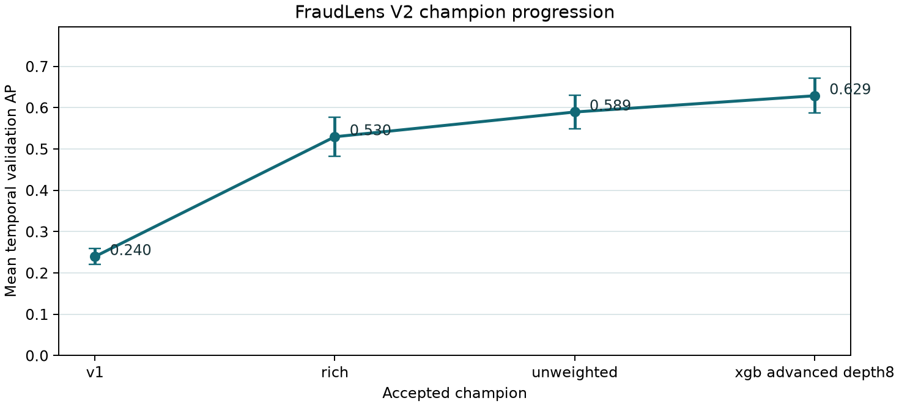
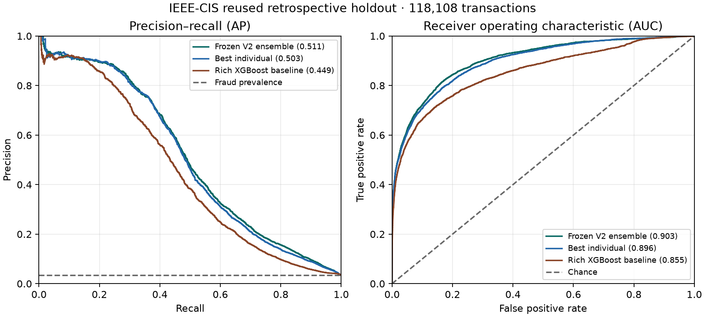
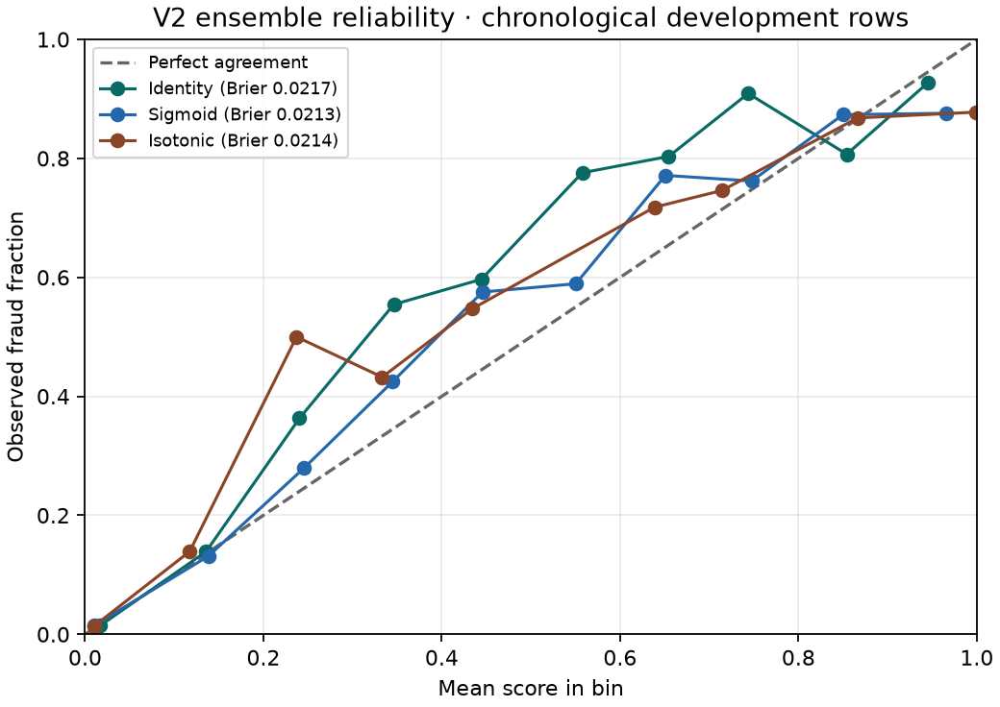

# FraudLens V2 experiments

The retrospective evaluation is complete.

## Diagnosis and method

V1 used a narrow 23-predictor view and capped each categorical input at 30 observed levels. The first V2 training fold alone contains 10,036 distinct `card1` values and 1,217 distinct device strings. The trade-off includes native category handling, train-only vocabulary, native numeric missing values, and more raw fields. These changes move together in the rich-to-V1 comparison. The controlled trials vary those inputs and class weighting separately.

The cache contains 431 raw predictors, one identity-join flag and seven V1 causal history features. It was built on 472,432 development rows in 50.22 seconds. Three timestamp-aligned expanding folds share their validation rows across candidates. The later decision-policy block contains 47,244 rows. The raw IEEE-CIS record layout cannot establish real-time availability of every anonymized field. The `no_vesta`, `no_identity` and `no_anonymous` controls examine sensitivity to that assumption without using final labels.

`D11` missingness falls across the early training and outer validation windows, while identity coverage also changes. These observed shifts help explain why fold-level variability matters. [V2 protocol](V2_PROTOCOL.md) · [Winning IEEE-CIS write-up](https://www.kaggle.com/solution-write-up-documentation) · [XGBoost paper](https://arxiv.org/abs/1603.02754) · [CatBoost paper](https://arxiv.org/abs/1706.09516)

| Partition | Train rows | Validation rows |
| --- | --- | --- |
| 1 | 212,594 | 70,865 |
| 2 | 283,459 | 70,865 |
| 3 | 354,324 | 70,864 |

## Development results

All rows below used the same three full validation blocks. Fit populations are shown separately. Every threshold-dependent fold metric uses one predeclared operating point for its score domain. Fold-level confusion matrices, review budgets and trial settings are saved in `artifacts/v2/trials/` and `artifacts/v2/challengers/`. Peak working set is the highest measured process working set for that run, which can include earlier trials in the same process.

| Candidate | Fit rows, fold 3 | AP fold 1 | AP fold 2 | AP fold 3 | Mean AP ± SD | ROC-AUC | Precision | Recall | F1 | Accuracy | Specificity | Fit s (all folds) | Score s (all folds) | Peak GiB |
| --- | --- | --- | --- | --- | --- | --- | --- | --- | --- | --- | --- | --- | --- | --- |
| `rich` | 354,324 | 0.55671 | 0.46375 | 0.56808 | 0.52952 ± 0.04673 | 0.87236 | 0.34303 | 0.60830 | 0.43747 | 0.93809 | 0.95154 | 241.48 | 5.78 | 2.78 |
| `v1` | 354,324 | 0.24870 | 0.21262 | 0.25720 | 0.23951 ± 0.01933 | 0.81177 | 0.13897 | 0.62817 | 0.22748 | 0.83070 | 0.83892 | 28.36 | 2.54 | 2.78 |
| `history` | 354,324 | 0.55666 | 0.46762 | 0.56684 | 0.53037 ± 0.04456 | 0.87158 | 0.34518 | 0.60801 | 0.43945 | 0.93867 | 0.95215 | 118.24 | 2.80 | 3.11 |
| `unweighted` | 354,324 | 0.61449 | 0.53235 | 0.62147 | 0.58944 ± 0.04047 | 0.90912 | 0.87074 | 0.37066 | 0.51855 | 0.97289 | 0.99768 | 95.62 | 1.67 | 3.11 |
| `xgb_advanced` | 354,324 | 0.56825 | 0.47538 | 0.57028 | 0.53797 ± 0.04427 | 0.87663 | 0.32275 | 0.62286 | 0.42434 | 0.93306 | 0.94569 | 112.11 | 2.47 | 3.07 |
| `lgbm` | 318,891 | 0.59524 | 0.50836 | 0.57463 | 0.55941 ± 0.03707 | 0.88663 | 0.83733 | 0.37050 | 0.51245 | 0.97220 | 0.99697 | 91.68 | 4.11 | 3.07 |
| `catboost` | 100,000 | 0.55575 | 0.46043 | 0.57826 | 0.53148 ± 0.05107 | 0.88144 | 0.84850 | 0.34038 | 0.48542 | 0.97149 | 0.99751 | 47.62 | 0.33 | 3.07 |
| `lgbm_leafwise` | 318,891 | 0.60424 | 0.51486 | 0.58740 | 0.56883 ± 0.03878 | 0.88648 | 0.62565 | 0.50058 | 0.55396 | 0.96810 | 0.98733 | 133.40 | 7.60 | 3.07 |
| `catboost_regularized` | 100,000 | 0.54465 | 0.45273 | 0.56648 | 0.52128 ± 0.04929 | 0.88294 | 0.23107 | 0.67750 | 0.34448 | 0.89785 | 0.90682 | 130.42 | 0.64 | 3.07 |
| `xgb_advanced_depth8` | 354,324 | 0.65989 | 0.56917 | 0.65723 | 0.62876 ± 0.04215 | 0.92317 | 0.88122 | 0.40072 | 0.54827 | 0.97411 | 0.99766 | 540.12 | 7.98 | 3.50 |
| `no_vesta` | 354,324 | 0.53908 | 0.46070 | 0.55504 | 0.51828 ± 0.04123 | 0.87379 | 0.32539 | 0.61677 | 0.42484 | 0.93380 | 0.94673 | 79.81 | 1.90 | 0.94 |
| `no_anonymous` | 354,324 | 0.29438 | 0.23565 | 0.28220 | 0.27075 ± 0.02531 | 0.80847 | 0.18667 | 0.56509 | 0.27995 | 0.88411 | 0.89715 | 55.95 | 1.24 | 0.94 |
| `dummy` | 16,000 | 0.04253 | 0.03497 | 0.04173 | 0.03974 ± 0.00339 | 0.50000 | — | 0.00000 | 0.00000 | 0.96026 | 1.00000 | 1.27 | 0.00 | 0.88 |
| `logistic` | 16,000 | 0.32484 | 0.27530 | 0.35176 | 0.31730 ± 0.03167 | 0.74414 | 0.12527 | 0.57117 | 0.20540 | 0.82482 | 0.83512 | 11.23 | 5.69 | 1.15 |
| `logistic_l2` | 16,000 | 0.36684 | 0.30646 | 0.41521 | 0.36284 ± 0.04449 | 0.81076 | 0.71434 | 0.24474 | 0.36323 | 0.96614 | 0.99591 | 17.61 | 12.34 | 1.30 |
| `gnb` | 16,000 | 0.15639 | 0.12693 | 0.20052 | 0.16128 ± 0.03024 | 0.72077 | 0.26547 | 0.36345 | 0.30665 | 0.93470 | 0.95825 | 7.18 | 5.31 | 1.30 |
| `gnb_smooth` | 16,000 | 0.16424 | 0.11923 | 0.20514 | 0.16287 ± 0.03508 | 0.69645 | 0.30898 | 0.34626 | 0.32595 | 0.94298 | 0.96759 | 6.98 | 5.44 | 1.30 |
| `knn` | 16,000 | 0.26201 | 0.21624 | 0.30620 | 0.26148 ± 0.03673 | 0.68220 | 0.73381 | 0.16539 | 0.26907 | 0.96451 | 0.99752 | 6.22 | 19.85 | 1.30 |
| `knn_neighbors` | 16,000 | 0.25234 | 0.21564 | 0.27979 | 0.24926 ± 0.02628 | 0.66032 | 0.75099 | 0.14096 | 0.23678 | 0.96411 | 0.99811 | 7.00 | 18.92 | 1.30 |
| `svm` | 16,000 | 0.30189 | 0.26912 | 0.34091 | 0.30397 ± 0.02935 | 0.72729 | 0.12797 | 0.55498 | 0.20778 | 0.83218 | 0.84349 | 34.17 | 5.84 | 1.30 |
| `svm_l2` | 16,000 | 0.37013 | 0.31080 | 0.40555 | 0.36216 ± 0.03909 | 0.78123 | 0.76459 | 0.22686 | 0.34927 | 0.96655 | 0.99709 | 19.19 | 12.15 | 1.30 |
| `decision_tree` | 16,000 | 0.27298 | 0.23048 | 0.32867 | 0.27738 ± 0.04021 | 0.72921 | 0.12901 | 0.55103 | 0.20890 | 0.83415 | 0.84558 | 7.74 | 5.36 | 1.30 |
| `decision_tree_depth` | 16,000 | 0.27364 | 0.22586 | 0.35680 | 0.28543 ± 0.05410 | 0.72176 | 0.64961 | 0.22089 | 0.32828 | 0.96450 | 0.99513 | 9.31 | 6.12 | 1.30 |
| `random_forest` | 16,000 | 0.36882 | 0.26784 | 0.40567 | 0.34744 ± 0.05826 | 0.76813 | 0.16473 | 0.53687 | 0.25200 | 0.87375 | 0.88745 | 9.61 | 10.74 | 1.30 |
| `random_forest_depth` | 16,000 | 0.40164 | 0.31829 | 0.42096 | 0.38030 ± 0.04455 | 0.78366 | 0.82483 | 0.21037 | 0.33373 | 0.96693 | 0.99814 | 17.18 | 13.79 | 1.30 |
| `adaboost` | 16,000 | 0.30621 | 0.23967 | 0.32358 | 0.28982 ± 0.03616 | 0.74580 | 0.12959 | 0.55343 | 0.20936 | 0.83428 | 0.84558 | 17.72 | 11.99 | 1.30 |
| `adaboost_depth` | 16,000 | 0.33774 | 0.26326 | 0.38409 | 0.32836 ± 0.04977 | 0.76946 | 0.81416 | 0.15371 | 0.25695 | 0.96506 | 0.99853 | 41.30 | 15.03 | 1.30 |
| `numpy_linear` | 16,000 | 0.33945 | 0.26887 | 0.40245 | 0.33692 ± 0.05457 | 0.76684 | 0.10767 | 0.64476 | 0.18177 | 0.74955 | 0.75317 | 11.02 | 5.30 | 1.43 |
| `numpy_linear_l2` | 16,000 | 0.37271 | 0.26191 | 0.39632 | 0.34365 ± 0.05860 | 0.78251 | 0.10929 | 0.65277 | 0.18579 | 0.76526 | 0.76932 | 11.17 | 5.29 | 1.44 |
| `numpy_relu` | 16,000 | 0.33548 | 0.26906 | 0.35510 | 0.31988 ± 0.03682 | 0.74913 | 0.11492 | 0.56794 | 0.19087 | 0.80700 | 0.81661 | 14.47 | 5.63 | 1.47 |
| `numpy_relu_wide` | 16,000 | 0.38901 | 0.25204 | 0.38486 | 0.34197 ± 0.06361 | 0.77567 | 0.12856 | 0.60702 | 0.20986 | 0.81387 | 0.82182 | 20.50 | 6.37 | 1.50 |
| `torch_mlp` | 16,000 | 0.40059 | 0.27855 | 0.40118 | 0.36011 ± 0.05767 | 0.77384 | 0.14591 | 0.58269 | 0.23267 | 0.84705 | 0.85757 | 41.67 | 5.64 | 1.76 |
| `torch_mlp_regularized` | 16,000 | 0.41496 | 0.30230 | 0.41097 | 0.37608 ± 0.05219 | 0.80743 | 0.78509 | 0.23233 | 0.35808 | 0.96712 | 0.99745 | 43.43 | 6.19 | 1.81 |
| `basic_native` | 354,324 | 0.25348 | 0.19804 | 0.25028 | 0.23394 ± 0.02541 | 0.78027 | 0.15395 | 0.55380 | 0.24062 | 0.86107 | 0.87363 | 46.99 | 1.19 | 0.57 |
| `no_identity` | 354,324 | 0.57066 | 0.47466 | 0.57922 | 0.54151 ± 0.04740 | 0.87713 | 0.32938 | 0.61961 | 0.42905 | 0.93470 | 0.94752 | 254.76 | 6.51 | 2.55 |
| `xgb_advanced_unweighted` | 354,324 | 0.62377 | 0.53135 | 0.62726 | 0.59413 ± 0.04441 | 0.91106 | 0.86004 | 0.38262 | 0.52630 | 0.97307 | 0.99730 | 301.25 | 7.59 | 3.00 |

The ten highest-gain raw features were checked in one-input, depth-three training-only probes. The highest outer-fold AP from those probes was 0.26740 from `V258`. This check can flag obvious single-feature proxies. It cannot establish the original production-time semantics of anonymized fields.

Accepted progression: **v1 → rich → unweighted → xgb_advanced_depth8**. The current individual champion gained **+0.38925 AP** (+162.5%) over the refitted V1 recipe on matched validation rows.

Raw labels, forecasts, serialized models and fold checkpoints are local artifacts. This table retains losing trials.

## Blends

The first two outer folds select model recipes and weights. The third outer fold checks the fixed blend.

| Blend | Component weights | Mean AP | Fold 3 AP |
| --- | --- | --- | --- |
| mean | xgb_advanced_depth8 0.250, lgbm_leafwise 0.250, catboost 0.250, torch_mlp_regularized 0.250 | 0.61157 | 0.63690 |
| weighted | xgb_advanced_depth8 0.772, lgbm_leafwise 0.076, catboost 0.076, torch_mlp_regularized 0.076 | 0.63425 | 0.66017 |

## Unsupervised results

Anomaly AP uses labeled validation rankings after fitting Isolation Forest without labels. DBSCAN quality and stability describe training samples. Apriori conditions were fitted on training and checked in later folds.

| Fold | Representation | Anomaly AP, 256 | Anomaly AP, 768 | Silhouette | Noise | Resample ARI |
| --- | --- | --- | --- | --- | --- | --- |
| 1 | core | 0.04693 | 0.04704 | 0.42345 | 23.91% | 0.93676 |
| 1 | enriched | 0.03691 | 0.03666 | 0.20510 | 46.91% | 0.96744 |
| 2 | core | 0.04344 | 0.04575 | 0.43024 | 23.31% | 0.94932 |
| 2 | enriched | 0.03467 | 0.03428 | 0.25213 | 47.20% | 0.96956 |
| 3 | core | 0.05025 | 0.05330 | 0.42854 | 23.20% | 0.97098 |
| 3 | enriched | 0.03759 | 0.03803 | 0.26086 | 50.17% | 0.98045 |

### Association stability

A validation rule is counted as supported when it has lift above 1, at least 100 antecedent matches and at least 30 fraud matches. Rule-level support, confidence, lift and counts are in `artifacts/v2/patterns.json`.

| Search | Rule | Found folds | Supported validation folds | Validation lifts |
| --- | --- | --- | --- | --- |
| additional_past_features | High 24h activity for card/address/email + High amount | 3 | 3 | 2.374, 2.043, 1.884 |
| additional_past_features | High 24h activity for card/address/email + High amount + Identity row missing | 1 | 1 | 1.876 |
| additional_past_features | High amount + High 24-hour activity | 2 | 2 | 1.382, 1.429 |
| additional_past_features | High amount + Identity row missing + High 24-hour activity | 1 | 1 | 1.206 |
| additional_past_features | High amount vs. card/address history + High amount | 1 | 0 | 0.768 |
| additional_past_features | No prior history | 3 | 3 | 2.442, 2.358, 2.736 |
| baseline | High amount + High 24-hour activity | 2 | 2 | 1.382, 1.429 |
| baseline | High amount + Identity row missing + High 24-hour activity | 1 | 1 | 1.206 |
| baseline | No prior history | 3 | 3 | 2.442, 2.358, 2.736 |

## Reused retrospective holdout

118,108 later rows and 4,064 fraud labels were scored once with the frozen V2 policy. Selected champion: **`ensemble_weighted`**. Fold 3 checkpoints were reused without fitting on the V2 decision-policy block.

| Model | AP | ROC-AUC | Precision | Recall | F1 | Accuracy | Specificity | Threshold | Score s | AP delta vs V1 | Relative AP delta |
| --- | --- | --- | --- | --- | --- | --- | --- | --- | --- | --- | --- |
| Archived V1 deployed XGBoost | 0.18778 | 0.79714 | 0.22920 | 0.34916 | 0.27674 | 0.93720 | 0.95816 | 0.748389 | 0.420 | — | — |
| `adaboost_depth` | 0.30493 | 0.77650 | 0.40274 | 0.36220 | 0.38140 | 0.95957 | 0.98086 | 0.257426 | 10.320 | +0.11715 | +62.4% |
| `catboost` | 0.44033 | 0.86074 | 0.43389 | 0.41831 | 0.42596 | 0.96120 | 0.98055 | 0.179604 | 0.857 | +0.25255 | +134.5% |
| `decision_tree_depth` | 0.28779 | 0.74945 | 0.28640 | 0.33538 | 0.30897 | 0.94838 | 0.97022 | 0.141653 | 4.254 | +0.10001 | +53.3% |
| `dummy` | 0.03441 | 0.50000 | — | 0.00000 | 0.00000 | 0.96559 | 1.00000 | 0.500000 | 0.130 | -0.15337 | -81.7% |
| `gnb_smooth` | 0.14691 | 0.67239 | 0.31653 | 0.34449 | 0.32992 | 0.95185 | 0.97349 | 0.114454 | 3.740 | -0.04087 | -21.8% |
| `history` | 0.45658 | 0.85449 | 0.51724 | 0.42815 | 0.46850 | 0.96657 | 0.98576 | 0.206276 | 5.241 | +0.26880 | +143.1% |
| `knn` | 0.20459 | 0.66388 | 0.37221 | 0.26624 | 0.31043 | 0.95930 | 0.98400 | 0.297030 | 10.975 | +0.01681 | +9.0% |
| `lgbm_leafwise` | 0.48433 | 0.86354 | 0.66971 | 0.39665 | 0.49822 | 0.97251 | 0.99303 | 0.312245 | 11.267 | +0.29655 | +157.9% |
| `logistic_l2` | 0.22605 | 0.80576 | 0.44498 | 0.27362 | 0.33887 | 0.96326 | 0.98784 | 0.311289 | 7.438 | +0.03827 | +20.4% |
| `numpy_linear_l2` | 0.27350 | 0.78620 | 0.41888 | 0.32530 | 0.36620 | 0.96126 | 0.98392 | 0.400000 | 3.426 | +0.08572 | +45.6% |
| `numpy_relu_wide` | 0.19172 | 0.78104 | 0.32693 | 0.30561 | 0.31591 | 0.95446 | 0.97758 | 0.227477 | 4.272 | +0.00394 | +2.1% |
| `random_forest_depth` | 0.34431 | 0.78065 | 0.45661 | 0.33661 | 0.38754 | 0.96339 | 0.98572 | 0.227272 | 8.167 | +0.15653 | +83.4% |
| `rich` | 0.44892 | 0.85461 | 0.53726 | 0.41511 | 0.46835 | 0.96757 | 0.98726 | 0.217358 | 3.420 | +0.26114 | +139.1% |
| `svm_l2` | 0.18967 | 0.77452 | 0.31207 | 0.34301 | 0.32681 | 0.95138 | 0.97305 | 0.128050 | 6.875 | +0.00189 | +1.0% |
| `torch_mlp_regularized` | 0.31993 | 0.78172 | 0.53769 | 0.30364 | 0.38811 | 0.96706 | 0.99070 | 0.277778 | 8.558 | +0.13215 | +70.4% |
| `unweighted` | 0.47272 | 0.88197 | 0.56972 | 0.41019 | 0.47697 | 0.96905 | 0.98896 | 0.216202 | 2.880 | +0.28494 | +151.7% |
| `xgb_advanced` | 0.46125 | 0.85798 | 0.55093 | 0.41388 | 0.47267 | 0.96822 | 0.98798 | 0.238478 | 4.259 | +0.27347 | +145.6% |
| `xgb_advanced_depth8` | 0.50316 | 0.89645 | 0.55970 | 0.46137 | 0.50580 | 0.96898 | 0.98707 | 0.220069 | 5.196 | +0.31538 | +168.0% |
| `xgb_advanced_unweighted` | 0.47434 | 0.88751 | 0.56097 | 0.41658 | 0.47811 | 0.96871 | 0.98838 | 0.277682 | 3.943 | +0.28656 | +152.6% |
| `ensemble_mean` | 0.50583 | 0.89991 | 0.58894 | 0.44808 | 0.50894 | 0.97025 | 0.98886 | 0.289209 | 25.878 | +0.31805 | +169.4% |
| `ensemble_weighted` | 0.51147 | 0.90325 | 0.62005 | 0.43529 | 0.51149 | 0.97139 | 0.99049 | 0.275293 | 25.878 | +0.32369 | +172.4% |

Archived V1 and V2 inference timings use their recorded scopes and implementations. The retrospective metrics use one frozen cutoff per model. ROC and precision–recall curves are stored by scorer.

The V2 champion's AP difference from archived V1 was **+0.32369**. The policy manifest records reliability bins, Brier scores, the calibration choice and the observed operating-point trade-offs.

### Error analysis by chronological period and history availability

| Segment | Rows | Fraud rows | AP | Recall | F1 |
| --- | --- | --- | --- | --- | --- |
| had prior proxy history | 101336 | 2339 | 0.31950 | 0.22959 | 0.31936 |
| cold start | 16772 | 1725 | 0.73236 | 0.71420 | 0.69330 |
| chronological third 1 | 39370 | 1285 | 0.49125 | 0.40233 | 0.48250 |
| chronological third 2 | 39369 | 1234 | 0.48727 | 0.43760 | 0.49564 |
| chronological third 3 | 39369 | 1545 | 0.55112 | 0.46084 | 0.54875 |

### Frozen decision and calibration

Calibration used 11,811 earlier development rows. Cutoff selection used 11,811 and policy evaluation used 23,622 later development rows. Selected calibrator: `identity`. Final Brier score: 0.022401. Raw final ranking AP before calibration: 0.51147.

| Calibration option | Later development Brier |
| --- | --- |
| identity | 0.021709 |
| sigmoid | 0.021320 |
| isotonic | 0.021442 |

| Development threshold objective | Cutoff | Precision | Recall | Reviewed |
| --- | --- | --- | --- | --- |
| high_precision | 0.13383 | 0.50000 | 0.59417 | 530 |
| high_recall | 0.07070 | 0.31144 | 0.70179 | 1005 |
| precision_at_least_85 | 0.94262 | 0.85246 | 0.11659 | 61 |
| recall_at_least_85 | 0.03254 | 0.17002 | 0.85202 | 2235 |

| Retrospective review budget | Rows reviewed | Precision | Recall |
| --- | --- | --- | --- |
| 1% | 1182 | 0.87394 | 0.25418 |
| 5% | 5906 | 0.38503 | 0.55955 |
| 10% | 11811 | 0.23698 | 0.68873 |

The raw-margin TreeSHAP check used 5 fixed retrospective rows for `xgb_advanced_depth8` (ensemble component). Maximum additivity error was 4.34e-06. The contribution unit is the raw component margin before calibration.

| Top model importance feature | Recorded importance |
| --- | --- |
| `V257` | 3584.41 |
| `V201` | 885.87 |
| `V258` | 596.71 |
| `V322` | 370.90 |
| `V172` | 345.27 |
| `V187` | 319.46 |
| `V295` | 302.74 |
| `V294` | 251.25 |
| `V243` | 192.83 |
| `V266` | 190.52 |

### Archived V1 primary models on the same retrospective rows

This comparison uses the same evaluation rows. Some V2 scorers trained on bounded matched subsets. Training budgets differ, so the measured differences include that experimental choice.

| V1 family | V2 scorer | V1 AP | V2 AP | AP delta | Relative AP delta | F1 delta |
| --- | --- | --- | --- | --- | --- | --- |
| dummy | dummy | 0.03441 | 0.03441 | +0.00000 | +0.0% | +0.00000 |
| logistic_regression | logistic_l2 | 0.11409 | 0.22605 | +0.11196 | +98.1% | +0.11448 |
| random_forest | random_forest_depth | 0.18521 | 0.34431 | +0.15910 | +85.9% | +0.10308 |
| xgboost | xgb_advanced_depth8 | 0.18778 | 0.50316 | +0.31538 | +168.0% | +0.22906 |
| mlp | torch_mlp_regularized | 0.15633 | 0.31993 | +0.16360 | +104.7% | +0.13248 |

## Archived V1 supplementary benchmark

These values describe V1’s separate matched historical subset. Its evaluation population differs from the full V2 retrospective population, so these values are retained as historical context.

| Archived V1 subset model | AP | ROC-AUC | Precision | Recall | F1 |
| --- | --- | --- | --- | --- | --- |
| dummy | 0.03450 | 0.50000 | — | 0.00000 | 0.00000 |
| logistic_regression | 0.11490 | 0.73193 | 0.19858 | 0.20290 | 0.20072 |
| random_forest | 0.20852 | 0.77268 | 0.28926 | 0.25362 | 0.27027 |
| xgboost | 0.22259 | 0.76088 | 0.28070 | 0.23188 | 0.25397 |
| gaussian_nb | 0.03597 | 0.52102 | 0.03604 | 0.95652 | 0.06946 |
| knn | 0.12866 | 0.70476 | 0.19380 | 0.18116 | 0.18727 |
| linear_svm | 0.11075 | 0.72677 | 0.20115 | 0.25362 | 0.22436 |
| adaboost | 0.17191 | 0.75702 | 0.20690 | 0.30435 | 0.24633 |
| sklearn_objective_reference | 0.11523 | 0.73208 | 0.21557 | 0.26087 | 0.23607 |
| numpy_linear | 0.11647 | 0.74309 | 0.19598 | 0.28261 | 0.23145 |
| numpy_relu32 | 0.12202 | 0.73583 | 0.23358 | 0.23188 | 0.23273 |
| torch_relu32_reference | 0.12202 | 0.73583 | 0.23358 | 0.23188 | 0.23273 |

## Aggregate figures







[Model Lab browser capture](screenshots/dashboard-v2-comparison.jpg) · [Pattern experiment browser capture](screenshots/dashboard-v2-patterns.jpg)

The frozen V2 cutoff produced 112,960 true negatives, 1,084 false positives, 2,295 false negatives and 1,769 true positives.

## Reproduction and checkpoints

Use Python 3.11 and the local V1 requirements plus `requirements-v2.txt`. Start with `python -m src.v2.experiment --help` and `python -m src.v2.challengers --help`. Both training entry points resume completed fold checkpoints. `src.v2.patterns` produces the unsupervised report and `src.v2.validation_report` rebuilds the selection ledger. `src.v2.final prepare` verifies completeness and freezes the decision policy. `src.v2.final evaluate` uses the frozen policy and an exclusive receipt before it opens retrospective labels. Keep the V1 source artifacts read-only.

Run from the V2 checkout. These commands use the original environment for V1 dependencies and install the extra packages into the V2 checkout. Choose a new output directory for an independent reproduction.

```powershell
$python = 'E:\fraudlens\.venv\Scripts\python.exe'
& $python -m pip install --target '.venv\Lib\site-packages' -r requirements-v2.txt
$env:PYTHONPATH = (Join-Path $PWD '.venv\Lib\site-packages')
$env:FRAUDLENS_ARTIFACTS = 'E:\fraudlens\artifacts'
$env:FRAUDLENS_V2_ARTIFACTS = (Join-Path $PWD 'artifacts\v2-reproduction')

$run = @{
    Python = $python
    RawData = 'E:\fraudlens\data\raw'
    V1Artifacts = 'E:\fraudlens\artifacts\full'
    OutputRoot = $env:FRAUDLENS_V2_ARTIFACTS
    Threads = 6
}
foreach ($stage in 'baseline', 'boosting', 'matched', 'patterns', 'finalize', 'evaluate') {
    & .\scripts\run_v2.ps1 @run -Stage $stage
}
& $python -m pip check
& $python -m pytest -q
& $python -m streamlit run app.py
```

To open the existing measured run, set `FRAUDLENS_V2_ARTIFACTS` to `E:\fraudlens-v2\artifacts\v2` and launch Streamlit. Select **Full** and **Final test**.
