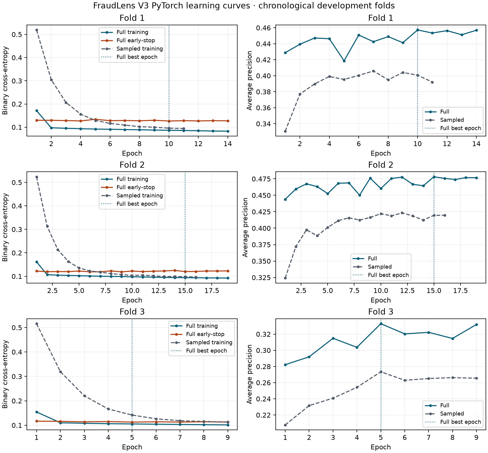

# FraudLens V3 Step 6A full-data PyTorch MLP

Mean external validation AP moved from **0.37608** to **0.40614** (+0.03006, +7.99% relative).

## Frozen design

The experiment uses the original 497-column V2 feature cache, excluding the archived Step 2 feature block. The full model refits the original frequency encoding, median imputation, missing indicators, ANOVA selection and scaling on gradient rows only. The selected 224 input columns are materialized in float32 batches. The final chronological tenth of each training prefix, adjusted to keep timestamps together, selects the checkpoint. The next chronological external fold is evaluated separately.

The architecture is `224 → 192 → 96 → 48 → 1`, with Linear → BatchNorm1d → GELU → Dropout(0.18) for every hidden layer and a final linear logit. It uses unweighted BCEWithLogitsLoss and AdamW (initial learning rate 0.0007, weight decay 0.002), cosine annealing over 20 epochs, shuffled batches up to 256, seed 42, six CPU threads, and AP patience 4. Selection uses the first epoch attaining the highest internal AP. Full-data epochs contain more optimizer steps. Internal scoring is batched and logs evaluation-mode BCE in addition to AP. The original V2 checkpoints saved training loss and internal AP each epoch, with no archived internal loss curve.

| Fold | Sampled gradient rows | Full gradient rows | Internal early-stop rows | External rows | Inputs | Parameters | Best epoch sampled/full | Epochs sampled/full |
| --- | ---: | ---: | ---: | ---: | ---: | ---: | ---: | ---: |
| 1 | 16,000 | 191,334 | 21,260 | 70,865 | 224 | 67,105 | 7/10 | 11/14 |
| 2 | 16,000 | 255,113 | 28,346 | 70,865 | 224 | 67,105 | 12/15 | 16/19 |
| 3 | 16,000 | 318,891 | 35,433 | 70,864 | 224 | 67,105 | 5/5 | 9/9 |

## External validation

Means weight each fold equally. Threshold-based metrics use 0.5. The two review budgets rank the same rows with source-order tie-breaking.

| Fold | Arm | AP | ROC-AUC | Precision | Recall | F1 | Accuracy | Recall at 5% | Recall at 10% |
| --- | --- | ---: | ---: | ---: | ---: | ---: | ---: | ---: | ---: |
| 1 | sampled | 0.41496 | 0.82207 | 0.82567 | 0.22628 | 0.35521 | 0.96506 | 0.41473 | 0.51029 |
| 1 | full | 0.43149 | 0.82376 | 0.72408 | 0.30823 | 0.43239 | 0.96558 | 0.43198 | 0.52986 |
| 2 | sampled | 0.30230 | 0.78890 | 0.70546 | 0.19814 | 0.30939 | 0.96907 | 0.37974 | 0.46086 |
| 2 | full | 0.32571 | 0.79749 | 0.72822 | 0.22599 | 0.34493 | 0.96999 | 0.39629 | 0.50444 |
| 3 | sampled | 0.41097 | 0.81133 | 0.82413 | 0.27257 | 0.40966 | 0.96722 | 0.43930 | 0.54582 |
| 3 | full | 0.46121 | 0.83689 | 0.76471 | 0.34292 | 0.47350 | 0.96818 | 0.45891 | 0.57558 |
| Mean | sampled | 0.37608 | 0.80743 | 0.78509 | 0.23233 | 0.35808 | 0.96712 | 0.41126 | 0.50565 |
| Mean | full | 0.40614 | 0.81938 | 0.73900 | 0.29238 | 0.41694 | 0.96792 | 0.42906 | 0.53663 |
| Mean change | full − sampled | 0.03006 | 0.01195 | -0.04608 | 0.06005 | 0.05886 | 0.00080 | 0.01780 | 0.03097 |

## Training versus external validation

Training metrics score each model on its own gradient-training population at its selected epoch. Those populations differ, and the gap includes temporal shift.

| Fold | Arm | Train AP | External AP | Train ROC-AUC | External ROC-AUC |
| --- | --- | ---: | ---: | ---: | ---: |
| 1 | sampled | 0.44758 | 0.41496 | 0.85410 | 0.82207 |
| 1 | full | 0.53117 | 0.43149 | 0.87461 | 0.82376 |
| 2 | sampled | 0.51677 | 0.30230 | 0.85698 | 0.78890 |
| 2 | full | 0.52469 | 0.32571 | 0.86644 | 0.79749 |
| 3 | sampled | 0.44192 | 0.41097 | 0.83105 | 0.81133 |
| 3 | full | 0.46440 | 0.46121 | 0.84080 | 0.83689 |
| Mean | sampled | 0.46876 | 0.37608 | 0.84738 | 0.80743 |
| Mean | full | 0.50675 | 0.40614 | 0.86062 | 0.81938 |

## Learning curves



Epoch-level values, learning rates and elapsed times are in the saved JSON.

## Seen and unseen entity proxies

A complete card–address–D1 key is seen if it occurred before the gradient cut. The table applies that same definition to both models on identical rows. The JSON also reports each model’s metrics using its actual fitted keys, including the smaller sampled key set.

| Fold | Group | External rows | Fraud prevalence | Sampled AP | Full AP |
| --- | --- | ---: | ---: | ---: | ---: |
| 1 | seen in fit | 25,228 | 1.78% | 0.05579 | 0.07307 |
| 1 | unseen in fit | 37,011 | 3.87% | 0.33494 | 0.34624 |
| 1 | missing key | 8,626 | 13.12% | 0.63862 | 0.65333 |
| 2 | seen in fit | 24,642 | 1.62% | 0.04432 | 0.08848 |
| 2 | unseen in fit | 38,641 | 3.25% | 0.18186 | 0.16935 |
| 2 | missing key | 7,582 | 10.87% | 0.62298 | 0.68418 |
| 3 | seen in fit | 25,970 | 1.45% | 0.02776 | 0.06894 |
| 3 | unseen in fit | 34,755 | 3.56% | 0.23002 | 0.27452 |
| 3 | missing key | 10,139 | 13.24% | 0.66471 | 0.71095 |
| Mean | seen in fit | — | — | 0.04262 | 0.07683 |
| Mean | unseen in fit | — | — | 0.24894 | 0.26337 |
| Mean | missing key | — | — | 0.64210 | 0.68282 |

## Resources and verification

Training includes preprocessing, gradient updates and internal scoring. Peak memory is process working set. Checkpoint size includes the model and fitted transform. The resumable epoch state also saves optimizer and RNG state separately.

| Fold | Arm | Training (s) | External inference (s) | Peak GiB | Checkpoint KiB |
| --- | --- | ---: | ---: | ---: | ---: |
| 1 | sampled (archived) | 12.69 | 1.98 | 1.76 | 264.15 |
| 1 | full | 196.46 | 0.89 | 1.31 | 294.13 |
| 2 | sampled (archived) | 18.03 | 1.95 | 1.76 | 263.64 |
| 2 | full | 275.08 | 2.39 | 1.50 | 295.48 |
| 3 | sampled (archived) | 12.71 | 2.26 | 1.81 | 263.70 |
| 3 | full | 166.38 | 1.98 | 1.69 | 296.79 |

Full-data training took 637.92 s. The supervised command took 693.03 s. Maximum full worker peak was 1.69 GiB. The largest reload difference across full external scores was `0` and across archived control scores was `0`. The sampled preprocessing parity probe differed by at most `0`.

## Reproduce or resume

The runner fits one fold at a time within a 45-minute wall-clock budget with a 7.5 GB worker memory guard. It verifies complete folds, and an interrupted fold resumes from its last recorded epoch. Use a fresh output directory for an independent run.

```powershell
Set-Location E:\fraudlens-v3
$python = 'E:\fraudlens\.venv\Scripts\python.exe'
$env:PYTHONPATH = 'E:\fraudlens-v2\.venv\Lib\site-packages'
$dev = 'E:\fraudlens-v2\artifacts\v2'
$out = 'artifacts\v3\step6a-torch'
& $python -B -m src.v3.torch_full --development $dev --output $out
& $python -B -m src.v3.torch_report --output $out --markdown 'docs\V3_STEP6A.md'
& $python -B -m pytest -q tests/test_v3_torch_full.py
```
