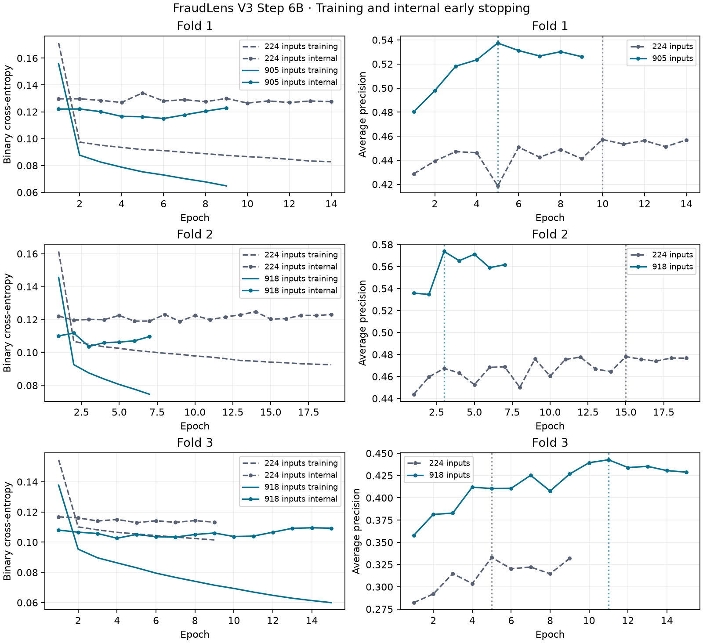

# FraudLens V3 Step 6B richer PyTorch inputs

**Keep the 224-input Step 6A MLP.** Mean external AP changed from 0.40614 to 0.41548 (+0.00935), with 2 improved folds. Mean ROC-AUC changed by +0.02698. The rule requires an AP gain of at least 0.01, improvement in at least two folds, and an AUC decline of at most 0.01. Depth-10 XGBoost remains the overall development champion.

## Representation and protocol

Step 6A starts from 497 V2 candidate columns. It replaces categories with training log-counts, imputes missing values with training medians, and appends one missing indicator per candidate. A supervised ANOVA F-score ranks those 994 columns and keeps the best 224, which are standardized. A value can be excluded even when its missing flag survives. All three controls excluded the values of `TransactionAmt`, `card1`, `D1`, `D4` and `prior_txn_count` alongside many anonymized Vesta fields.

The challenger retains all 460 approved numerical values and 37 single-column categorical frequency encodings. It adds only missing indicators that vary on the gradient rows. It retains the existing missing and unseen-category handling and uses no supervised feature ranking. Labels, transaction IDs, raw timestamps, entity keys and the rejected Step 2 columns are excluded. The per-fold JSON lists every retained and omitted control value and flag by name.

Only the first layer's input width changes in the architecture. Both networks use 192, 96 and 48 hidden units with BatchNorm, GELU and dropout 0.18, followed by a single logit. Both use AdamW, unweighted binary cross-entropy, cosine scheduling, seed 42 and six CPU threads. Preprocessing uses gradient-training rows only. Gradient, internal early-stopping and external validation populations exactly match Step 6A. The internal AP selects checkpoints.

| Fold | Old → new width | Control values / flags | Omitted control values / Vesta values | New flags | Old → new parameters | Gradient / internal / external rows | Best epoch / total, control → challenger |
| --- | ---: | ---: | ---: | ---: | ---: | ---: | ---: |
| 1 | 224 → 905 | 126 / 98 | 371 / 222 | 408 | 67,105 → 197,857 | 191,334 / 21,260 / 70,865 | 10 / 14 → 5 / 9 |
| 2 | 224 → 918 | 110 / 114 | 387 / 238 | 421 | 67,105 → 200,353 | 255,113 / 28,346 / 70,865 | 15 / 19 → 3 / 7 |
| 3 | 224 → 918 | 107 / 117 | 390 / 241 | 421 | 67,105 → 200,353 | 318,891 / 35,433 / 70,864 | 5 / 9 → 11 / 15 |

## External validation

Decision metrics use 0.5. Review budgets rank the highest-scored rows within the fold. Means weight folds equally.

| Fold | Arm | AP | ROC-AUC | Precision | Recall | F1 | Accuracy | Recall at 5% | Recall at 10% |
| --- | --- | ---: | ---: | ---: | ---: | ---: | ---: | ---: | ---: |
| 1 | control | 0.43149 | 0.82376 | 0.72408 | 0.30823 | 0.43239 | 0.96558 | 0.43198 | 0.52986 |
| 1 | challenger | 0.48966 | 0.84375 | 0.81481 | 0.30657 | 0.44552 | 0.96754 | 0.48474 | 0.60816 |
| 2 | control | 0.32571 | 0.79749 | 0.72822 | 0.22599 | 0.34493 | 0.96999 | 0.39629 | 0.50444 |
| 2 | challenger | 0.24001 | 0.83531 | 0.38540 | 0.24294 | 0.29802 | 0.95998 | 0.41687 | 0.56295 |
| 3 | control | 0.46121 | 0.83689 | 0.76471 | 0.34292 | 0.47350 | 0.96818 | 0.45891 | 0.57558 |
| 3 | challenger | 0.51678 | 0.86003 | 0.73859 | 0.38316 | 0.50456 | 0.96860 | 0.51539 | 0.62834 |
| Mean | control | 0.40614 | 0.81938 | 0.73900 | 0.29238 | 0.41694 | 0.96792 | 0.42906 | 0.53663 |
| Mean | challenger | 0.41548 | 0.84636 | 0.64627 | 0.31089 | 0.41603 | 0.96538 | 0.47233 | 0.59982 |
| Mean change | challenger − control | 0.00935 | 0.02698 | -0.09273 | 0.01851 | -0.00091 | -0.00254 | 0.04327 | 0.06319 |

## Paired entity-block uncertainty

The 1,000 paired bootstrap resamples use shared block weights for the two score sets. Complete card–address–D1 keys are shared across folds. Incomplete keys are singleton blocks. The intervals describe these fitted models on observed development periods.

| Fold | AP change | 95% interval |
| --- | ---: | --- |
| 1 | +0.05818 | [+0.03818, +0.07921] |
| 2 | -0.08570 | [-0.10708, -0.06381] |
| 3 | +0.05556 | [+0.03421, +0.07944] |
| Mean | +0.00935 | [-0.00509, +0.02369] |

## Learning curves and overfitting



| Fold | Arm | Train AP | External AP | AP gap | Train ROC-AUC | External ROC-AUC |
| --- | --- | ---: | ---: | ---: | ---: | ---: |
| 1 | control | 0.53117 | 0.43149 | 0.09968 | 0.87461 | 0.82376 |
| 1 | challenger | 0.64727 | 0.48966 | 0.15761 | 0.92445 | 0.84375 |
| 2 | control | 0.52469 | 0.32571 | 0.19898 | 0.86644 | 0.79749 |
| 2 | challenger | 0.59918 | 0.24001 | 0.35917 | 0.91008 | 0.83531 |
| 3 | control | 0.46440 | 0.46121 | 0.00318 | 0.84080 | 0.83689 |
| 3 | challenger | 0.76067 | 0.51678 | 0.24389 | 0.95235 | 0.86003 |
| Mean | control | 0.50675 | 0.40614 | 0.10062 | 0.86062 | 0.81938 |
| Mean | challenger | 0.66904 | 0.41548 | 0.25356 | 0.92896 | 0.84636 |

The in-sample versus later external gap includes temporal differences. The plotted early-stop curves use the same timestamp-aligned internal populations. Epoch values are in the JSON.

## Seen and unseen entity proxies

Seen keys appeared among the gradient rows. Both models use the same groups and prevalence.

| Fold | Entity stratum | Rows | Fraud rate | Control AP | Challenger AP |
| --- | --- | ---: | ---: | ---: | ---: |
| 1 | seen in fit | 25,228 | 1.78% | 0.07307 | 0.19062 |
| 1 | unseen in fit | 37,011 | 3.87% | 0.34624 | 0.36010 |
| 1 | missing key | 8,626 | 13.12% | 0.65333 | 0.74933 |
| 2 | seen in fit | 24,642 | 1.62% | 0.08848 | 0.05620 |
| 2 | unseen in fit | 38,641 | 3.25% | 0.16935 | 0.16073 |
| 2 | missing key | 7,582 | 10.87% | 0.68418 | 0.64111 |
| 3 | seen in fit | 25,970 | 1.45% | 0.06894 | 0.28115 |
| 3 | unseen in fit | 34,755 | 3.56% | 0.27452 | 0.29306 |
| 3 | missing key | 10,139 | 13.24% | 0.71095 | 0.75758 |
| Mean | seen in fit | — | — | 0.07683 | 0.17599 |
| Mean | unseen in fit | — | — | 0.26337 | 0.27130 |
| Mean | missing key | — | — | 0.68282 | 0.71601 |

## Resources and verification

Training time includes preprocessing and internal scoring. Working set is measured per worker. Checkpoint sizes include the fitted preprocessor.

| Fold | Arm | Training (s) | External inference (s) | Peak GiB | Checkpoint KiB |
| --- | --- | ---: | ---: | ---: | ---: |
| 1 | control (Step 6A) | 196.46 | 0.89 | 1.31 | 294.13 |
| 1 | challenger | 136.52 | 2.85 | 1.69 | 816.13 |
| 2 | control (Step 6A) | 275.08 | 2.39 | 1.50 | 295.48 |
| 2 | challenger | 134.48 | 2.81 | 2.08 | 827.68 |
| 3 | control (Step 6A) | 166.38 | 1.98 | 1.69 | 296.79 |
| 3 | challenger | 131.01 | 1.69 | 2.45 | 829.11 |

Challenger training totaled 402.00 s, with 447.42 s command wall time and a maximum 2.45 GiB worker peak. Maximum replay error across both arms' external scores was `0`.

## Reproduce or resume

The runner retains one epoch checkpoint per fold with the latest optimizer state and best weights. It reuses verified completed folds and limits training to 45 minutes and a 7.5 GB worker guard.

```powershell
Set-Location E:\fraudlens-v3
$python = 'E:\fraudlens\.venv\Scripts\python.exe'
$env:PYTHONPATH = 'E:\fraudlens-v2\.venv\Lib\site-packages'
$dev = 'E:\fraudlens-v2\artifacts\v2'
$control = 'artifacts\v3\step6a-torch'
$out = 'artifacts\v3\step6b-rich'
& $python -B -m src.v3.torch_rich --development $dev --control $control --output $out
& $python -B -m src.v3.torch_rich_report --development $dev --control $control --output $out --markdown 'docs\V3_STEP6B.md'
```
