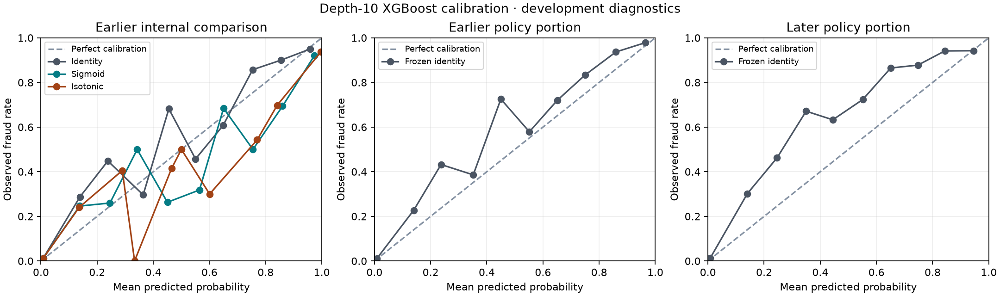
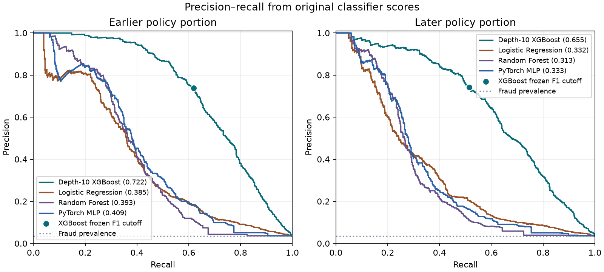

# FraudLens V3 Step 7B final decision policy

**Depth-10 XGBoost remains primary.** Its frozen calibration method is **identity**. The four classifiers and their Step 7A predictions were reused. All policy numbers describe a previously inspected development block.

## Chronological partitions

| Portion | Rows | Fraud rows | First second | Last second |
| --- | ---: | ---: | ---: | ---: |
| Earlier | 23,622 | 824 | 10,766,698 | 11,449,871 |
| Later | 23,622 | 830 | 11,449,894 | 12,192,842 |

Calibration comparison fits on the first 11,811 earlier rows and compares on the next 11,811. The internal cut is between seconds 11,050,813 and 11,050,823. The `develop` command writes the immutable calibration and threshold manifest before `verify` loads the later labels or computes its metrics.

## Calibration selection

The rule preserves identity unless both 95% paired day-block bootstrap intervals for loss differences lie below zero. The comparison uses 6 elapsed-day blocks and 2,000 resamples. A sigmoid also needs a positive slope. When several methods pass, the lowest Brier score wins, with log loss breaking ties. The selected method is then fitted on the whole earlier portion. Identity has no fitted parameters. A negative loss difference favors the calibration method.

| Method | Brier | Log loss | Brier difference, 95% interval | Log loss difference, 95% interval | Eligible |
| --- | ---: | ---: | --- | --- | --- |
| identity | 0.020182 | 0.080638 | [+0.000000, +0.000000] | [+0.000000, +0.000000] | Reference |
| sigmoid | 0.020123 | 0.080729 | [-0.000689, +0.000950] | [-0.002223, +0.003385] | No |
| isotonic | 0.020391 | 0.125241 | [-0.000422, +0.001143] | [+0.019098, +0.077867] | No |

Neither alternative cleared both loss criteria, so identity was retained.



## Ranking and probability metrics

AP, ROC-AUC, precision–recall curves and review budgets always use original scores. The budgets rank within each portion, break ties in source order, and round up to whole reviews. Brier and log loss evaluate the displayed probability values. Only XGBoost was eligible for calibration. Other models retain their original probability outputs.

| Portion | Model | AP | ROC-AUC | Original Brier | Policy Brier | Original log loss | Policy log loss | Recall at 1% | Recall at 5% | Recall at 10% |
| --- | --- | ---: | ---: | ---: | ---: | ---: | ---: | ---: | ---: | ---: |
| Earlier | Logistic Regression | 0.38521 | 0.84605 | 0.02655 | 0.02655 | 0.11721 | 0.11721 | 0.22573 | 0.44782 | 0.58495 |
| Earlier | Random Forest | 0.39271 | 0.75208 | 0.02561 | 0.02561 | 0.11430 | 0.11430 | 0.23786 | 0.45146 | 0.53519 |
| Earlier | Depth-10 XGBoost | 0.72166 | 0.95043 | 0.01673 | 0.01673 | 0.06754 | 0.06754 | 0.28155 | 0.73665 | 0.84951 |
| Earlier | PyTorch MLP | 0.40872 | 0.81587 | 0.02540 | 0.02540 | 0.11089 | 0.11089 | 0.23665 | 0.47573 | 0.57646 |
| Later | Logistic Regression | 0.33220 | 0.82443 | 0.02806 | 0.02806 | 0.11772 | 0.11772 | 0.18554 | 0.41566 | 0.53494 |
| Later | Random Forest | 0.31277 | 0.73597 | 0.02799 | 0.02799 | 0.12451 | 0.12451 | 0.20602 | 0.36024 | 0.46747 |
| Later | Depth-10 XGBoost | 0.65521 | 0.94256 | 0.02009 | 0.02009 | 0.07916 | 0.07916 | 0.26506 | 0.69759 | 0.81928 |
| Later | PyTorch MLP | 0.33304 | 0.78210 | 0.02770 | 0.02770 | 0.12092 | 0.12092 | 0.20602 | 0.38313 | 0.49398 |



## Frozen thresholds and workload

The primary and model-specific thresholds maximize earlier-portion F1, breaking ties at the highest cutoff. XGBoost's alternatives maximize recall at 90% precision and precision at 70% recall on the earlier portion. The default 0.5 applies to policy probabilities. When XGBoost uses a transformation, the original-score 0.5 comparison is shown separately. Confusion matrices show `[TN, FP]` and `[FN, TP]` rows. Reviews per 1,000 transaction rows describe observed workload, which may change on future data.

| Portion | Model | Policy | Threshold | Precision | Recall | F1 | Accuracy | Confusion matrix | Reviews | Reviews per 1,000 |
| --- | --- | --- | ---: | ---: | ---: | ---: | ---: | --- | ---: | ---: |
| Earlier | Logistic Regression | fixed 0.5 | 0.5 | 0.66272 | 0.27184 | 0.38554 | 0.96977 | `[[22684, 114], [600, 224]]` | 338 | 14.3 |
| Earlier | Logistic Regression | selected f1 | 0.2944795427 | 0.53080 | 0.35558 | 0.42587 | 0.96656 | `[[22539, 259], [531, 293]]` | 552 | 23.4 |
| Earlier | Random Forest | fixed 0.5 | 0.5 | 0.79412 | 0.26214 | 0.39416 | 0.97189 | `[[22742, 56], [608, 216]]` | 272 | 11.5 |
| Earlier | Random Forest | selected f1 | 0.1963565625 | 0.53707 | 0.36044 | 0.43137 | 0.96685 | `[[22542, 256], [527, 297]]` | 553 | 23.4 |
| Earlier | Depth-10 XGBoost | fixed 0.5 | 0.5 | 0.87583 | 0.47937 | 0.61961 | 0.97947 | `[[22742, 56], [429, 395]]` | 451 | 19.1 |
| Earlier | Depth-10 XGBoost | selected f1 | 0.1938110143 | 0.73913 | 0.61893 | 0.67371 | 0.97909 | `[[22618, 180], [314, 510]]` | 690 | 29.2 |
| Earlier | Depth-10 XGBoost | high precision | 0.5581119061 | 0.90094 | 0.46359 | 0.61218 | 0.97951 | `[[22756, 42], [442, 382]]` | 424 | 17.9 |
| Earlier | Depth-10 XGBoost | high recall | 0.0981483534 | 0.57758 | 0.70024 | 0.63302 | 0.97168 | `[[22376, 422], [247, 577]]` | 999 | 42.3 |
| Earlier | PyTorch MLP | fixed 0.5 | 0.5 | 0.79528 | 0.24515 | 0.37477 | 0.97147 | `[[22746, 52], [622, 202]]` | 254 | 10.8 |
| Earlier | PyTorch MLP | selected f1 | 0.2504911423 | 0.62611 | 0.34345 | 0.44357 | 0.96994 | `[[22629, 169], [541, 283]]` | 452 | 19.1 |
| Later | Logistic Regression | fixed 0.5 | 0.5 | 0.71212 | 0.16988 | 0.27432 | 0.96842 | `[[22735, 57], [689, 141]]` | 198 | 8.4 |
| Later | Logistic Regression | selected f1 | 0.2944795427 | 0.49043 | 0.24699 | 0.32853 | 0.96452 | `[[22579, 213], [625, 205]]` | 418 | 17.7 |
| Later | Random Forest | fixed 0.5 | 0.5 | 0.78756 | 0.18313 | 0.29717 | 0.96956 | `[[22751, 41], [678, 152]]` | 193 | 8.2 |
| Later | Random Forest | selected f1 | 0.1963565625 | 0.46934 | 0.26747 | 0.34075 | 0.96364 | `[[22541, 251], [608, 222]]` | 473 | 20.0 |
| Later | Depth-10 XGBoost | fixed 0.5 | 0.5 | 0.89130 | 0.34578 | 0.49826 | 0.97553 | `[[22757, 35], [543, 287]]` | 322 | 13.6 |
| Later | Depth-10 XGBoost | selected f1 | 0.1938110143 | 0.74261 | 0.51446 | 0.60783 | 0.97667 | `[[22644, 148], [403, 427]]` | 575 | 24.3 |
| Later | Depth-10 XGBoost | high precision | 0.5581119061 | 0.90878 | 0.32410 | 0.47780 | 0.97511 | `[[22765, 27], [561, 269]]` | 296 | 12.5 |
| Later | Depth-10 XGBoost | high recall | 0.0981483534 | 0.57236 | 0.63373 | 0.60149 | 0.97049 | `[[22399, 393], [304, 526]]` | 919 | 38.9 |
| Later | PyTorch MLP | fixed 0.5 | 0.5 | 0.83648 | 0.16024 | 0.26896 | 0.96939 | `[[22766, 26], [697, 133]]` | 159 | 6.7 |
| Later | PyTorch MLP | selected f1 | 0.2504911423 | 0.59557 | 0.25904 | 0.36104 | 0.96778 | `[[22646, 146], [615, 215]]` | 361 | 15.3 |

## Reproduce and verify

The local policy artifact directory holds verified model and prediction hashes, the decision freeze, and detailed metrics. The calibrator parameters, if any, are stored in the decision freeze. No classifier checkpoints were changed.

```powershell
Set-Location E:\fraudlens-v3
$python = 'E:\fraudlens\.venv\Scripts\python.exe'
$env:PYTHONPATH = 'E:\fraudlens-v2\.venv\Lib\site-packages'
$dev = 'E:\fraudlens-v2\artifacts\v2'
$refit = 'artifacts\v3\step7a-refit'
$out = 'artifacts\v3\step7b-policy'
& $python -B -m src.v3.decision_policy develop --development $dev --refit $refit --output $out
& $python -B -m src.v3.decision_policy verify --development $dev --refit $refit --output $out
& $python -B -m src.v3.decision_policy_report --output $out --markdown 'docs\V3_STEP7B.md'
& $python -B -m pytest -q tests/test_v3_decision_policy.py
```
