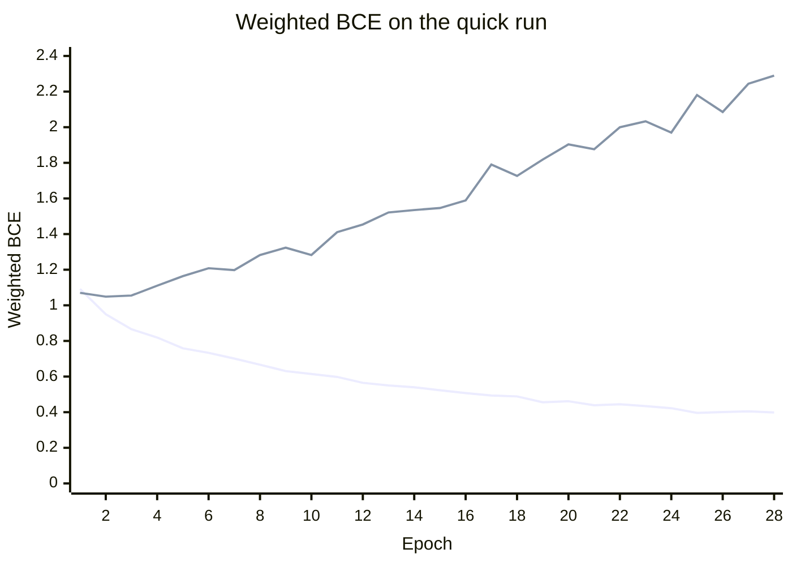
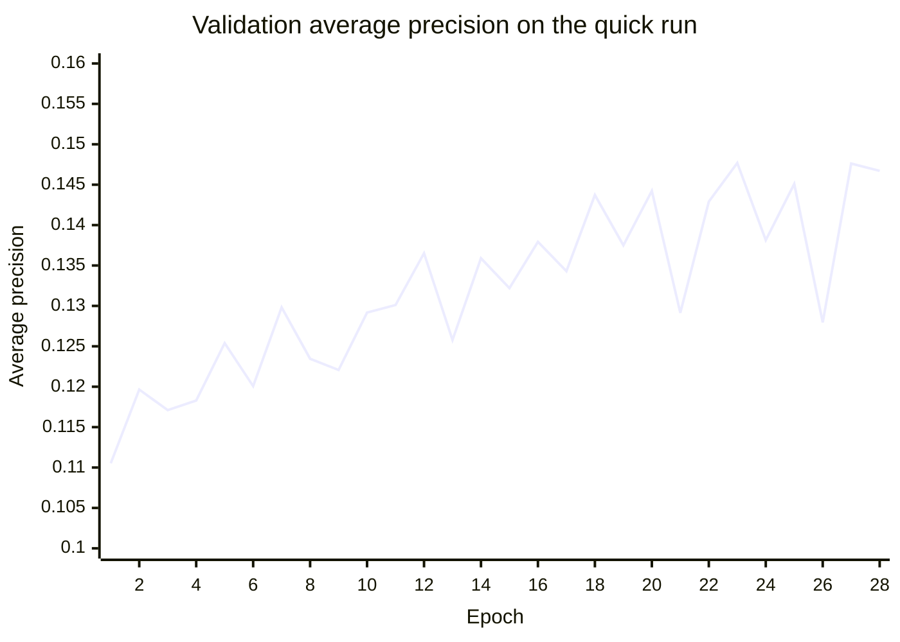

# PyTorch fraud benchmark: quick-run engineering note

## Run and reload

```powershell
.\.venv\Scripts\python.exe -m pip install --index-url https://download.pytorch.org/whl/cpu torch==2.14.1+cpu
.\.venv\Scripts\python.exe -m pip install -r requirements.txt
.\.venv\Scripts\python.exe -m src.train_mlp --mode quick --threads 6
.\.venv\Scripts\python.exe -m pytest -q
```

Install the pinned CPU wheel from the official PyTorch index before installing the requirements. The quick run verified PyTorch 2.14.1+cpu with Python 3.11.8 on Windows and an i5-12450H. [Official PyTorch installation commands](https://pytorch.org/get-started/previous-versions/)

`src/train_mlp.py` checks the existing Phase 1 split manifest and loads the fitted Phase 2 behavioral preprocessor. It verifies the input feature order and compares the evaluation IDs, elapsed times and labels with the existing classical outputs. `src/neural.py` defines `FraudMLP`, the batch loader, the weighted training loop and checkpoint reloading. The MLP uses all 60,000 training rows and the same 20,000 validation and 20,000 quick-test rows as the core classical run. Each dense feature batch uses at most 0.65 MiB. The underlying feature matrix stays sparse.

`artifacts/quick/phase2b/manifest.json` points to an immutable run snapshot with `best_model.pt`, `selection.json`, `training_history.json`, `comparison.json` and the metrics, ROC/PR curves and predictions for both evaluation partitions. `load_checkpoint(checkpoint_path, input_dim)` loads the tensor-only state on CPU. Load the matching preprocessor using the manifest's mode-relative path and verify its hash and feature order before scoring. Full mode expects corresponding Phase 1 and Phase 2 artifacts.

## Network and training mechanics

For a batch of 512 transactions, the preprocessor yields a `512 × 331` feature tensor. The first layer computes `Z₁ = X W₁ᵀ + b₁` with shape `512 × 128`. Each unit learns weights for its input values and adds a bias. Batch normalization, ReLU and dropout follow the first layer. A second block repeats those steps with 64 units, yielding a `512 × 64` tensor. The output layer maps each row to one raw logit, so the forward method returns shape `(512,)`. The total number of trainable parameters is `128 × (331 + 1) + 2 × 128 + 64 × (128 + 1) + 2 × 64 + 65 = 51,201`.

- **ReLU** applies `max(0, z)` in the hidden layers so that the network can learn nonlinear relationships. Scoring applies `sigmoid(z) = 1 / (1 + exp(−z))` to the final logits. A logit of zero gives a score of 0.5. The weighted model scores are uncalibrated.
- **Weighted binary cross-entropy** uses the stable logit formula `L(z, y) = (1 − y) softplus(z) + w y softplus(−z)`. Here `w = 58,358 / 1,642 = 35.5408`, calculated from training labels, so positive-row errors carry more weight. Each epoch's loss is the sample-weighted mean of its batch means, with the same positive-class weight in training and validation.
- **Backpropagation** computes `∂L/∂θ` by the chain rule when `loss.backward()` runs. PyTorch autograd stores the gradients and Adam updates each parameter using moving averages of gradients and squared gradients. The update has the form `θ ← θ − η m̂ / (√v̂ + ε)` with learning rate `η = 0.001`. Weight decay adds an L2 penalty to discourage large weights, with coefficient `0.0001` in the optimizer.
- **Batch normalization** centers and scales activations with `γ (x − μ) / √(σ² + ε) + β`, using batch statistics in training and running statistics in evaluation. **Dropout** randomly masks 25% of the hidden activations in training and is disabled in evaluation. Evaluation uses `torch.inference_mode()`.
- An **epoch** traverses the shuffled training rows in mini-batches of up to 512. Batch normalization requires two or more training observations per batch, so only a final training singleton is skipped when one occurs. The real run had a 96-row final training batch and dropped zero rows. Evaluation preserves all rows in chronological order.
- **Early stopping** tracks validation AP and saves the first checkpoint at each new best. After five epochs without improvement, it restores the best weights and BatchNorm buffers. The validation threshold then maximizes F1. Ties use the higher cutoff. The checkpoint and cutoff are saved before reading quick test.

## Observed training curves and comparison

The exact curves, learning rate and timing for all 28 epochs are in `training_history.json`. In the loss chart, training starts at 1.09130 and validation at 1.07011.





Validation loss was lowest at epoch 2 (1.04864). By epoch 28, training loss was 0.39809 and validation loss was 2.28937. That divergence is consistent with overfitting to the weighted loss, while validation ranking improved through epoch 23. The checkpoint objective was AP, so the run restored epoch 23 and used its F1-maximizing threshold of 0.8366163373. Training and epoch validation took 68.25 seconds, and the complete run took 72.46 seconds on six CPU threads.

| Model | Validation AP | Validation F1 | Quick-test AP | Quick-test F1 |
| --- | ---: | ---: | ---: | ---: |
| Majority dummy | 0.02415 | 0.00000 | 0.02180 | 0.00000 |
| Logistic regression | 0.09368 | 0.17698 | 0.08013 | 0.15058 |
| Random forest | 0.12489 | 0.20387 | 0.10699 | 0.19284 |
| XGBoost with history | 0.14535 | 0.20395 | 0.12542 | 0.21429 |
| XGBoost basic ablation | 0.13630 | 0.21200 | 0.13444 | 0.24699 |
| PyTorch MLP | 0.14768 | 0.23178 | 0.19452 | 0.25311 |

The MLP caught 159 of 483 fraud cases in validation and 183 of 436 in quick test. Its validation AP was 0.00233 above the classical champion, and its quick-test AP was 0.06911 higher on this early chronological slice. XGBoost with history remains the selected classical model. The full suite passed 37 tests, and a separate reload reproduced all 40,000 scores and decisions exactly under the recorded configuration.
